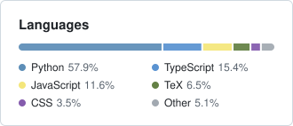

<picture>
  <source media="(prefers-color-scheme: dark)" srcset="cards/native-overview-dark.svg">
  
</picture>
<picture>
  <source media="(prefers-color-scheme: dark)" srcset="cards/native-languages-dark.svg">
  
</picture>
